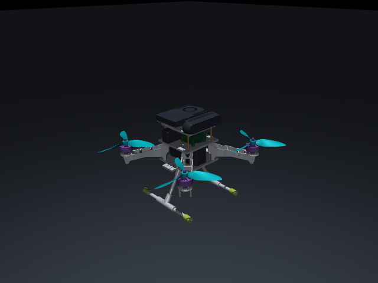

# 首轮验证记录

日期：2026-10-29。目的：验证项目骨架、物理施力和结果记录，不代表训练算法或真机性能验收。

## 环境和检查

- Windows，Python 3.12.15，独立 `.venv`；MuJoCo 3.15.0、NumPy 2.5.4、SciPy 1.18.1。
- 可编辑安装成功；安装后的 `aerogauge` 命令可运行；依赖检查无冲突。
- 12 个基础测试通过：不对称配平、自由飞行平衡、单电机合矩/完整惯量响应、重置、质量偏差、重心、执行器滞后/延迟、风力方向、16 维观测、异常输入、有界分配及成功/失败结果保存。
- MuJoCo 独立环境未安装 PyTorch，两个可选 actor 测试在该环境跳过；另用本地 Python 3.13 / PyTorch 2.6.0+cpu 完成两个合成 TorchScript 接口测试。测试内容是动作映射、重置和拒绝错误契约，不是 PyTorch 2.7 真实 checkpoint 验证。
- 67 个复制来源文件及包内副本的 SHA256 一致；原主目录源文件保持原值。原压缩包的机体配置与本地机体配置逐字节一致。
- 已实际完成 640×480 MuJoCo 离屏渲染，见下图。只证明当前模型可渲染，未测试交互 viewer。

## 实际运行结果

均采用默认基线控制器、10 s 回合；下表 RMSE 是整段三维位置误差，不是末段误差。

| 测试 | 种子数 | 达到当前门槛 | 位置 RMSE |
|---|---:|---:|---:|
| 标称悬停 | 3 | 3/3 | 三回合平均 0.03197 m |
| 0.5 m 位置阶跃 | 1 | 1/1 | 0.13735 m |
| 圆形跟踪 | 1 | 1/1 | 0.03959 m |
| 质量增加 10%，控制器不重新整定 | 1 | 0/1 | 0.23556 m |
| 电机 τ=20 ms，延迟 4 ms | 1 | 1/1 | 0.03392 m |
| 0.5 N、0.2 s 外力脉冲 | 1 | 1/1 | 0.03702 m |
| 简化机体风阻演示，2 m/s | 1 | 1/1 | 0.03542 m |

质量失配没有提前失稳，但末段跟踪误差超限，因此记录为未通过。没有为通过测试调整控制器或门槛。风演示阻力面积未标定，不能将结果解释为实机通过 2 m/s 抗风验证。样本量仅用于开发验证，不能据此估计可靠性或比较算法优劣。

关闭电机的失败试验在自动测试中确认：提前终止、保留轨迹与终止原因、计入分母。重复使用输出目录会被拒绝。

结构化摘要见 [results.json](validation/results.json)；本机依赖快照见 [requirements-windows-py312.txt](validation/requirements-windows-py312.txt)。完整运行轨迹和 manifest 保留在被 Git 忽略的 `outputs/`。每次运行记录自己的源码哈希，不能把不同阶段文件视为完全相同的源代码版本。

## 尚未验证

Ubuntu Python 3.11、GitHub Actions、MuJoCo 3.16/3.17、目标 PyTorch 2.7/cu128 的真实策略、交互窗口、地面起飞/降落、运动平台、视觉、实机。下一步优先将一个明确契约的悬停 actor 导出，与训练环境离线对齐观测和动作，再开展 Sim-to-Sim 对照。
